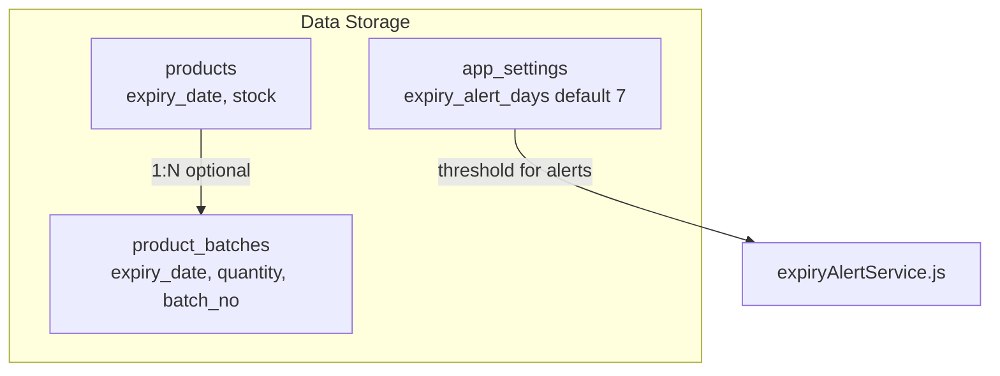
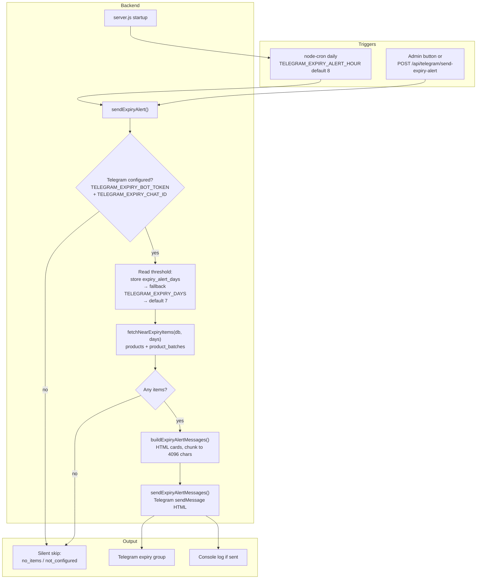
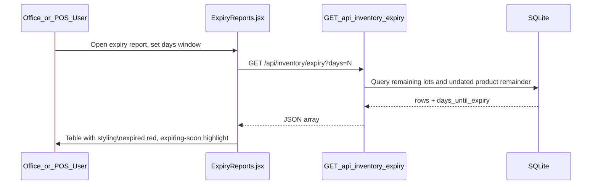
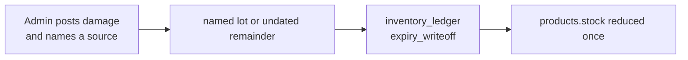
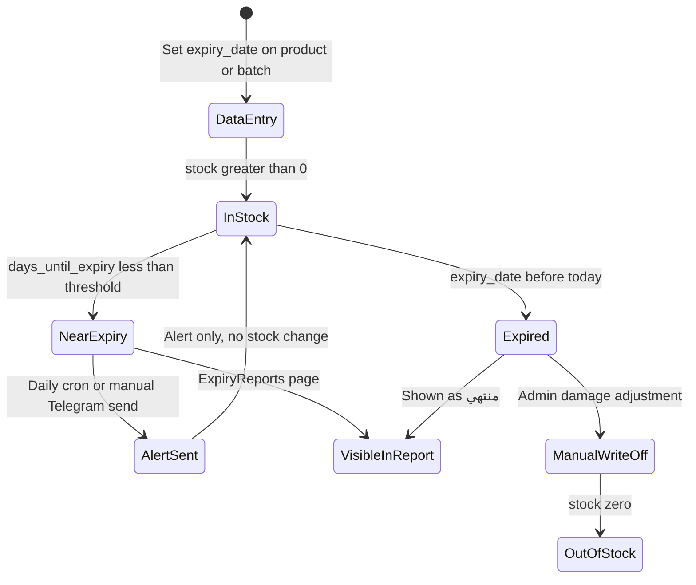

# Expiration Process — How It Works

## Summary

In this codebase, **expiration is a monitoring and alerting system**, not an automatic disposal pipeline. The system:

- Stores `expiry_date` on products (a single legacy date) and on `product_batches` (one remaining quantity per expiry)
- Computes **days until expiry** with SQLite `julianday()`
- Shows the office expiry report from remaining lot quantities, plus the undated remainder when the product still has its own date
- Sends **daily Telegram alerts** for items nearing expiry (plus manual send from store settings)
- Deducts dated lots on sale in earliest-expiry order, and restores the same lots on refund
- Lets an inventory issue name the dated lot or the undated remainder it takes from
- Lets a stock count record a quantity for every dated lot and for undated stock

It does **not** automatically remove expired stock or block checkout for expired products. A damage adjustment still uses ledger type `expiry_writeoff`, and it now reduces the lot or undated remainder the user names.

---

## 1. Data Model

Two places hold expiry information:

| Layer | Table / field | Purpose |
|-------|---------------|---------|
| Product-level | `products.expiry_date` | Single expiry date per SKU (YYYY-MM-DD) |
| Batch-level | `product_batches` | Optional lots with their own `expiry_date`, `quantity`, `batch_no` |



**Key files:**

- Schema: `backend/database/init.js` — `expiry_date` column on `products`, `product_batches` table
- Product CRUD: `backend/routes/products.js` — set/update `expiry_date` on create/edit
- Batch CRUD: `backend/routes/inventory.js` — `GET/POST/DELETE /api/inventory/batches`

---

## 2. Expiry Query Logic (shared everywhere)

All expiry queries use the same SQLite pattern:

```sql
CAST(julianday(expiry_date) - julianday('now') AS INTEGER) AS days_until_expiry
```

**Inclusion rule for alerts** (`fetchNearExpiryItems` in `backend/services/expiryAlertService.js`):

- `expiry_date` is set and non-empty
- `stock > 0` (products) or `quantity > 0` (batches)
- Expires within **N days** (including already expired: `days_until_expiry` can be negative)

**Office report** (`GET /api/inventory/expiry`, `listOfficeExpiryReport`), **dashboard** (`GET /api/reports/near-expiry`), and **Telegram alerts** (`fetchNearExpiryItems`) use that same window. The office default is 30 days. Each dated lot with remaining quantity above zero is one row. A product-level `expiry_date` is a separate row only for the undated remainder (`products.stock` minus the sum of every dated lot). A depleted lot is omitted. An already-expired lot is included while it still has quantity. If the dated sum is already above on-hand, the negative remainder is not shown and the lot quantities are left as stored.

**Label formatting** (`formatDaysLabel` in `backend/utils/telegram.js`):

- Negative days → `منتهي منذ يوم` / `يومين` / `X أيام` / `X يوماً` (already expired)
- Zero → `ينتهي اليوم`
- Positive → `ينتهي خلال …` with the same Arabic day plural

Telegram alerts send **HTML** (`parse_mode: HTML`): bold product name, `<code>` for `DD/MM/YYYY` dates and barcodes. Items are grouped by urgency (expired, today, upcoming) as multi-line cards. Messages over ~4096 characters split on blank lines; continuation parts start with `تتمة — تنبيه صلاحية`.

---

## 3. Telegram Alert Flow (main “expiration process”)

This is the only **automated** expiration workflow.



**Configuration chain:**

1. **Disable entirely:** `DISABLE_EXPIRY_TELEGRAM_ALERT=1` in `.env.example`
2. **Alert hour:** `TELEGRAM_EXPIRY_ALERT_HOUR` (0–23, default 8) — scheduled in `backend/server.js`
3. **Days threshold:** `expiry_alert_days` in store settings (`frontend/src/pages/StoreSettings.jsx`) → persisted via `backend/utils/settings.js` → env fallback `TELEGRAM_EXPIRY_DAYS=7`
4. **Telegram bot:** separate expiry bot (`TELEGRAM_EXPIRY_BOT_TOKEN`, `TELEGRAM_EXPIRY_CHAT_ID`) — send-only, no approve/reject buttons

**Core service:** `backend/services/expiryAlertService.js`  
**Message builder/sender:** `backend/utils/telegram.js`  
**Manual API:** `backend/routes/telegram.js` — admin-only `POST /api/telegram/send-expiry-alert`

For Telegram setup steps, see also `REFUNDS_GUIDE.md` (expiry bot section).

---

## 4. Reporting Flow (UI)



**UI locations:**

- Office: `frontend/src/pages/ExpiryReports.jsx` (one row per lot, plus a product-date row for unassigned quantity)

**Product dashboard** also shows expiry on a single product: `GET /api/products/:id/overview` in `backend/routes/products.js` returns `expiry.expiry_date` and `days_until_expiry`.

---

## 5. Manual Expired Stock Handling

An inventory issue (every reason on that document, including damaged) writes ledger type `manual_adjustment`. When the product has dated lots, each line must name `batch_source`: `dated` with that lot's expiry, or `undated` with an explicit null expiry. A missing source is rejected. The named lot quantity, the allocation row, the product stock, and the ledger move in one transaction. A product with no dated lots keeps a product-only line and does not write a lot allocation.

A stock count of a product with dated lots stores a counted quantity for every lot, including zero, and for undated stock. An empty input is not a count of zero. Posting replaces those sources with the counted quantities and writes one company stock movement for the net change. A reshuffle that keeps the same total writes lot allocation history and no company stock movement. If a source quantity changed after the line was saved, posting is rejected and the session stays open. A product with no dated lots still uses one counted quantity and the previous live-stock rule.

Older issue lines have `batch_source` null. That null is not an undated allocation. A lot row is not deleted while it still has quantity or allocation history. A complete count is what reconciles a case where dated quantities already exceed on-hand stock; it does not invent an expiry or rewrite old documents.

Stock-count lines that already exist when source uniqueness is introduced stay stored as they were, including two product-only lines for the same session and product with different counted quantities. Those rows are marked `line_origin = legacy` and sit outside `idx_sc_line_source`. Lines inserted afterward are `current`. The unique index applies to them, and an insert or update cannot label a new line as legacy. A second initialization does not change the stored rows.

A stock adjustment of type `damage`, `out`, or `correction` names the same dated lot or undated remainder as an inventory issue. `correction` uses the signed quantity on that source. An adjustment of type `in`, and an inventory receipt, increase a dated lot when an expiry is supplied and increase undated stock when it is not. Bakery consumption (`adjustment_type = consumption`) does not ask for a lot; it uses the same earliest-expiry allocation as a sale and shop consumption. Zero-all-stock sets every dated lot to zero, writes the undated remainder into allocation history, and records the product stock change once. A second zero-all finds nothing left to move. Pre-existing inconsistencies are still corrected by a complete physical count, not by rewriting old documents.



Mapping in `backend/utils/inventory.js`: `damage` → ledger type `expiry_writeoff`.  
There is **no cron or automatic job** that creates these write-offs when `expiry_date` passes.

---

## 6. What Is NOT Part of Expiration

| Expected behavior | Status in codebase |
|-------------------|-------------------|
| Auto write-off at midnight when expired | Not implemented |
| Block POS sale of expired product | Not implemented |
| Deduct `product_batches` on checkout (FEFO) | Implemented in `stockBatchService.js`: earliest dated lot, then undated stock. Refunds restore the original allocation |
| Inventory issue, stock count, damage, correction, or receipt by lot | Implemented. Damage, out, and correction name a source. Consumption follows earliest expiry. A receipt uses the expiry on the line, or stays undated |
| Expiry bot interactive commands | Not implemented — alerts are outbound only |

---

## 7. End-to-End Lifecycle (conceptual)



---

## Key Takeaway

The **expiration process** = **track dates → query with `julianday` → report in UI → notify via Telegram → optionally manual write-off**. Alerts inform staff; they do not change inventory. Operational response (discount, remove from shelf, write off) is manual outside the automated alert loop.
